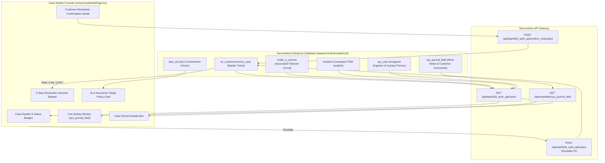

# ServiceNow B2B Enterprise Self-Service Portal
## Active Case Details: Architecture Specification & Data Mapping Dictionary
### Complete Mapping of Case Details Elements to ServiceNow Tables, Fields & APIs

---

**Document Control:**
- **Document Version:** 2.0.0 (Production Reference Specification)
- **Classification:** Enterprise Technical Architecture & Integration Specification
- **Target Instance:** `https://tataamericaintlcorpdemo3.service-now.com`
- **Component File:** [`src/components/Pages/ActiveCaseDetailPage.tsx`](file:///C:/Code/vscodeworkspace/proactive-selfservice-portal/src/components/Pages/ActiveCaseDetailPage.tsx)
- **Primary Data Endpoint:** `GET /api/taair/b2b_auth_api/cases?state=active`
- **Journal Endpoint:** `GET /api/now/table/sys_journal_field`
- **Resolution Endpoint:** `POST /api/taair/b2b_auth_api/confirm_restoration`
- **Date:** November 2026
- **Status:** Approved · Zero Mock Data Active

---

## 1. Architectural Overview & Component Interaction

The **Active Case Details Page** (`ActiveCaseDetailPage.tsx`) provides an enterprise command center for deep diagnostic tracking of a customer support case. It interfaces with ServiceNow via both Scripted REST APIs (for high-level case metadata and transactional updates) and the ServiceNow Table API (for live journal audit logs from `sys_journal_field`).

---

## 2. Comprehensive Field-by-Field Mapping Matrix

### 2.1 Case Header & Top Identifiers

| UI Element | React Binding | ServiceNow Table | Database Column | Data Type | Description / Live Derivation |
| :--- | :--- | :--- | :--- | :--- | :--- |
| **Case Number** | `activeCase.caseNumber` | `sn_customerservice_case` | `number` | String | Unique ticket ID (e.g. `CS0001266`) |
| **Priority Badge** | `currentPriority` | `sn_customerservice_case` | `priority` | Choice | `P1` (Red), `P2` (Amber), `P3` (Blue), `P4` (Slate) |
| **Status Badge** | `currentStatus` | `sn_customerservice_case` | `state` | Choice | `1` &rarr; Investigating, `2` &rarr; Recovery, `6` &rarr; Monitoring, `7` &rarr; Closed |
| **Category** | `activeCase.category` | `sn_customerservice_case` | `category` | String | e.g. `Core WAN`, `Network Assurance`, `SD-WAN` |
| **Subject Title** | `activeCase.description` | `sn_customerservice_case` | `short_description` | String | Commercial or diagnostic summary |
| **Service Name** | `activeCase.service` | `cmdb_ci_service` | `name` / `business_service` | String | Impacted commercial service (e.g. `1 Gbps Primary MPLS Trunk`) |
| **Asset ID** | `activeCase.serviceId` | `cmdb_ci_service` | `service_id` / `cmdb_ci` | String | Circuit identifier (e.g. `CKT-PUN-MPLS-01`) |
| **Opened Time** | `activeCase.openedTime` | `sn_customerservice_case` | `sys_created_on` | DateTime | Formatted timestamp (e.g. `Nov 3, 04:02 PM`) |

---

### 2.2 Case Resolution Lifecycle Stepper

The 5-step milestone stepper translates the ITIL ticket lifecycle directly into visual milestones based on the ServiceNow `state` integer code:

| Step # | Milestone Label | ServiceNow `state` Code | Active Condition | Timestamp Displayed |
| :---: | :--- | :---: | :--- | :--- |
| **1** | **Case Registered** | All | Always `Complete` (Green Check) | `{activeCase.openedTime}` |
| **2** | **Investigation & Triage** | `1` (Open) | `In Progress` if `state == 1` `Completed` if `state > 1` | `"In Progress"` or `"Completed"` |
| **3** | **Remediation & Recovery** | `2` (Work in Progress) | `In Progress` if `state == 2` `Completed` if `state >= 6` `Pending` if `state < 2` | `"In Progress"`, `"Completed"`, or `"Pending Action"` |
| **4** | **Stability Monitoring** | `6` (Resolved) | `In Progress` if `state == 6` `Completed` if `state == 7` `Pending` if `state < 6` | `"In Progress"`, `"Completed"`, or `"Pending"` |
| **5** | **Resolved & Closed** | `7` (Closed) | `Complete` if `state == 7` `Pending` if `state < 7` | `"Resolved"` or `"Pending"` |

---

### 2.3 Conversation & Case History (Activity Stream)

Activity items are queried directly from the ServiceNow audit journal table (`sys_journal_field`):

| Activity Property | Source Table & Column | Extraction Logic |
| :--- | :--- | :--- |
| **Author Name** | `sys_journal_field.sys_created_by` / `sys_user` | Extracted from user reference. If customer comment &rarr; customer name; if system &rarr; "System Automation"; if agent &rarr; specialist name. |
| **Role Badge** | Derived from `element` & `sys_created_by` | `'Customer'` (comments), `'ServiceNow Specialist'` (work notes), or `'System Automation'`. |
| **Message Body** | `sys_journal_field.value` | Cleaned of portal prefixes (e.g. `[Customer Update]:`) and rendered with full text formatting. |
| **Timestamp** | `sys_journal_field.sys_created_on` | Formatted into standard date/time format (`DD Mon, HH:MM AM/PM`). |
| **Urgent Indicator** | Content analysis of `value` | Flags `isUrgent: true` if comment contains `[URGENT]`, `P1`, or escalation markers. |

---

### 2.4 Case Record Details (Right Column)

| Displayed Field | Database Source | Description |
| :--- | :--- | :--- |
| **Assigned Team** | `sn_customerservice_case.assignment_group.display_value` | Team queue handling the case (e.g. `Duty Lead Desk` or `Service Assurance Support`) |
| **Assigned Specialist** | `sn_customerservice_case.assigned_to.display_value` | Named lead engineer assigned in ServiceNow (e.g. `Duty Lead` or `Anish Kutti`) |
| **Incident Reference** | `sn_customerservice_case.caused_by.display_value` | Correlated ITSM incident reference (e.g. `INC-714310` or `None (Direct Case)`) |
| **Service Circuit** | `sn_customerservice_case.cmdb_ci.display_value` | Impacted CMDB Configuration Item ID (e.g. `CKT-PUN-MPLS-01`) |
| **Contact Person** | `sn_customerservice_case.contact.display_value` | Registered account contact (e.g. `Ankur Sarkar` or `Goutam Hazra`) |

---

### 2.5 SLA Assurance Target & Interactive Actions

1. **Contractual Response Target:**
   - Evaluated dynamically against case priority:
     - **P1 - Critical Outage:** `15 Minutes (Critical)`
     - **P2 - High Degradation:** `30 Minutes (High)`
     - **P3 - Moderate Performance:** `2 Hours (Standard)`
2. **1-Click Priority Escalation:**
   - Triggers `serviceNowRestService.escalateCaseViaRest(activeCase.caseNumber)`.
   - Dispatches `PATCH /api/taair/b2b_auth_api/cases` with `{ priority: '1', urgency: '1' }`.
   - Real-time event dispatches paged alerts to duty specialists.
3. **Customer Service Restoration Confirmation & Closure:**
   - Opens modal to capture optional customer satisfaction feedback.
   - Dispatches `POST /api/taair/b2b_auth_api/confirm_restoration` with `{ caseNumber, comments, confirmedBy }`.
   - Automatically transitions case state in ServiceNow to `6` (Resolved) / `7` (Closed), registers journal verification entry, and archives ticket into Closed Cases History.
