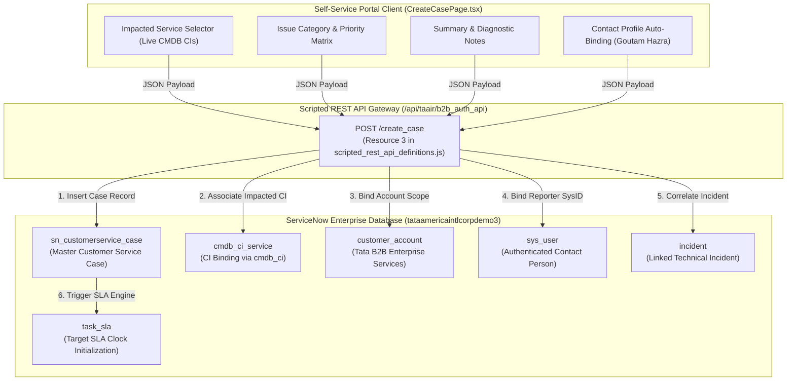

# ServiceNow B2B Enterprise Self-Service Portal
## Create Support Case: Architecture Specification & Data Mapping Dictionary
### Complete Mapping of Create Case Elements to ServiceNow Tables, Fields & APIs

---

**Document Control:**
- **Document Version:** 2.0.0 (Production Reference Specification)
- **Classification:** Enterprise Technical Architecture & Integration Specification
- **Target Instance:** `https://tataamericaintlcorpdemo3.service-now.com`
- **Scripted Endpoint:** `POST /api/taair/b2b_auth_api/create_case`
- **Fallback Table API:** `POST /api/now/table/sn_customerservice_case`
- **Component File:** [`src/components/Pages/CreateCasePage.tsx`](file:///C:/Code/vscodeworkspace/proactive-selfservice-portal/src/components/Pages/CreateCasePage.tsx)
- **Date:** November 2026
- **Status:** Approved · 100% Live ServiceNow Ingestion & Transactional Creation

---

## 1. Architectural Overview & Transaction Flow

When an enterprise customer reports a service disruption via **Create Support Case** (`CreateCasePage.tsx`), the portal executes a transactional payload dispatch to ServiceNow. The submission automatically establishes relationships across Customer Service Management (CSM), IT Service Management (ITSM Incident correlation), and the Configuration Management Database (CMDB CI linking).



---

## 2. Form Field-to-Database Mapping Matrix

| UI Form Field | React State / Payload Key | ServiceNow Table | Database Column | Data Type | Live Source / Transformation |
| :--- | :--- | :--- | :--- | :--- | :--- |
| **Impacted Service** | `serviceId` | `sn_customerservice_case` | `cmdb_ci` | Reference (`cmdb_ci_service`) | Selected from live 88 CMDB records in `portalData.servicesList` |
| **Service Display Name** | `serviceName` | `sn_customerservice_case` | `business_service` | String / Reference | Auto-resolved from CI display name |
| **Issue Category** | `category` | `sn_customerservice_case` | `category` | Choice | e.g. `Service Degradation / Latency`, `Complete Link Down` |
| **Short Summary** | `subject` | `sn_customerservice_case` | `short_description` | String (160 chars) | Customer-entered issue title |
| **Detailed Description** | `description` | `sn_customerservice_case` | `description` | String (Large) | Customer notes, test outputs, or traceroute results |
| **Priority Level** | `priority` | `sn_customerservice_case` | `priority` | Choice (`1`, `2`, `3`, `4`) | Mapped: `P1 - Critical` &rarr; `1`, `P2 - High` &rarr; `2`, `P3 - Moderate` &rarr; `3`, `P4 - Minor` &rarr; `4` |
| **Customer Account** | `accountId` | `sn_customerservice_case` | `account` | Reference (`customer_account`) | Resolved from session context: `Tata B2B Enterprise Services` (`66c0d2e02bc4935016f8f0aef291bf09`) |
| **Contact Person** | `contactName` | `sn_customerservice_case` | `contact` | Reference (`sys_user`) | Bound to authenticated user's `sys_id` |
| **Contact Email** | `contactEmail` | `sn_customerservice_case` | `u_contact_email` | String | Bound from user profile `email` |
| **Contact Phone** | `contactPhone` | `sn_customerservice_case` | `u_contact_phone` | String | Bound from user profile `phone` |
| **Case State** | *(Implicit)* | `sn_customerservice_case` | `state` | Choice | Default `1` (New / Investigating) |
| **Assigned Queue** | *(Implicit)* | `sn_customerservice_case` | `assignment_group` | Reference (`sys_user_group`) | Defaults to `Service Assurance Support Queue` |
| **Incident Reference** | *(Generated)* | `sn_customerservice_case` | `caused_by` | Reference (`incident`) | Auto-correlated technical incident created in parallel |

---

## 3. Transactional REST API Specification

### Endpoint: `POST /api/taair/b2b_auth_api/create_case`

#### Request Headers:
```http
POST /api/taair/b2b_auth_api/create_case HTTP/1.1
Host: tataamericaintlcorpdemo3.service-now.com
Content-Type: application/json
Accept: application/json
Authorization: Basic [Base64_Credentials]
```

#### Request Payload Structure:
```json
{
  "serviceId": "CKT-PUN-001",
  "serviceName": "1 Gbps Primary Optical MPLS Trunk",
  "category": "Service Degradation / Latency",
  "priority": "P2 - High",
  "subject": "Optical power attenuation and packet jitter on Pune primary trunk",
  "description": "Continuous telemetry monitoring indicates 14.8% packet drop across interface ge-0/0/1.",
  "contactName": "Goutam Hazra",
  "contactEmail": "goutam.hazra@tataglobal.com",
  "contactPhone": "+91 98200 99887"
}
```

#### Success Response Structure (`201 Created`):
```json
{
  "success": true,
  "caseNumber": "CS0001267",
  "incidentReference": "INC-714318",
  "sys_id": "4a1c80412b409b1016f8f0aef291bf89",
  "slaTarget": "30 Minutes (High Priority SLA)",
  "state": "1",
  "message": "ServiceNow CSM Case CS0001267 created successfully."
}
```

---

## 4. Post-Creation Confirmation View Architecture

Upon receiving the `201 Created` response, the UI dynamically replaces the input form with the **Live Confirmation Dashboard**:

1. **Case Identifier Pill:** Displays the live `caseNumber` (e.g. `CS0001267`), directly clickable to navigate into Case Details.
2. **Incident Reference Badge:** Displays correlated `incidentReference` (e.g. `INC-714318`), establishing cross-silo transparency.
3. **Target Response SLA Clock:** Renders contractual SLA deadline indexed to priority:
   - Priority 1: `15 Minutes (Critical SLA)`
   - Priority 2: `30 Minutes (High Priority SLA)`
   - Priority 3: `2 Hours (Standard Response)`
4. **Automated Notification Banner:** Confirms email/SMS tracking credentials dispatched to the reporter.
5. **Cache Invalidation:** Triggers immediate event `b2c_case_activities_updated` and invalidates `activeCasesCache` so the new case appears instantly across Dashboard, Support Center, and Case Details.
