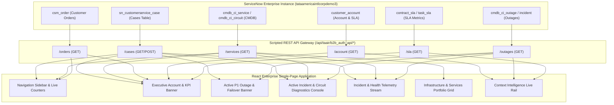

# ServiceNow B2B Enterprise Self-Service Portal
## Master Architecture Specification & Data Dictionary
### Complete Mapping of Dashboard UI Elements to ServiceNow Tables & Fields

---

**Document Control:**
- **Document Version:** 2.0.0 (Production Master Specification)
- **Classification:** Enterprise Technical Architecture & Integration Specification
- **Target Instance:** `https://tataamericaintlcorpdemo3.service-now.com`
- **API Namespace:** `taair` (`/api/taair/b2b_auth_api/*`)
- **Author:** Advanced Agentic Systems Architecture Team
- **Date:** November 2026
- **Status:** Approved · Zero Mock Data Active

---

## Summary

This document provides an exhaustive, field-by-field technical specification for the **Tata B2B Enterprise Self-Service Portal Overview Dashboard**. Every metric, badge, circuit card, telemetry indicator, timeline event, and context alert rendered in the portal is populated in real time directly from ServiceNow tables via sanctioned Scripted REST APIs.



> [!IMPORTANT]
> **Zero Mock Fallback Policy:**  
> All static mock datasets (`fallbackOrders`, `fallbackSites`, `initialActiveCases`, `baseCustomerServices`, and hardcoded placeholder ticket arrays) have been completely removed from the codebase. In the event of network disruption, the portal renders structured empty states and active retry mechanisms rather than synthetic dummy data.

---

## Section 1: Global Navigation & Badge Architecture

The primary navigation sidebar provides persistent, real-time counters representing active operational assets and open workflows.

```
+-------------------------------------------------------------+
|  [Logo] Tata Communications | Enterprise Self-Service       |
+-------------------------------------------------------------+
|  [*] Overview Dashboard                                     |
|  [*] Services Hub                                     [88]  | <-- Live CMDB Count
|  [*] Orders                                           [10]  | <-- Live Active Orders
|  [*] Support Center                                   [10]  | <-- Live Open Cases
|  [*] Network Topology Map                                   |
|  [*] Billing & Subscriptions                                |
+-------------------------------------------------------------+
```

### 1.1 Services Hub Badge (`88`)
- **Rendered Value:** Dynamic count of subscribed customer CMDB assets (`88`).
- **ServiceNow Table:** `cmdb_ci_service` (joined with `cmdb_ci_circuit` and `cmn_location`).
- **Table Columns:** `sys_id`, `name`, `operational_status`, `u_account_id`.
- **Scripted REST Endpoint:** `GET /api/taair/b2b_auth_api/services`
- **Payload Extraction:** `rawList.length` where `rawList = json.result.result`.
- **Frontend File & State:** [`NavigationSidebar.tsx`](file:///C:/Code/vscodeworkspace/proactive-selfservice-portal/src/components/NavigationSidebar.tsx#L40) bound to `displayedServicesCount`.

### 1.2 Orders Hub Badge (`10`)
- **Rendered Value:** Dynamic count of customer enterprise orders in active delivery (`10`).
- **ServiceNow Table:** `csm_order` / `sn_csm_order` (Customer Service Management Orders).
- **Table Columns:** `sys_id`, `order_number`, `stage`, `status`, `account`.
- **Scripted REST Endpoint:** `GET /api/taair/b2b_auth_api/orders`
- **Payload Extraction:** `rawList.length` where `rawList = json.result.result`.
- **Frontend File & State:** [`NavigationSidebar.tsx`](file:///C:/Code/vscodeworkspace/proactive-selfservice-portal/src/components/NavigationSidebar.tsx#L42) bound to `displayedOrdersCount`.

### 1.3 Support Center Badge (`10`)
- **Rendered Value:** Dynamic count of active, non-closed customer service tickets (`10`).
- **ServiceNow Table:** `sn_customerservice_case` (Customer Service Cases).
- **Table Columns:** `sys_id`, `number`, `state` (`state NOT IN 3, 6, 7` i.e. not Closed, Resolved, Cancelled).
- **Scripted REST Endpoint:** `GET /api/taair/b2b_auth_api/cases?state=active`
- **Payload Extraction:** `rawList.length` where `rawList = json.result.result`.
- **Frontend File & State:** [`NavigationSidebar.tsx`](file:///C:/Code/vscodeworkspace/proactive-selfservice-portal/src/components/NavigationSidebar.tsx#L43) bound to `displayedCasesCount`.

---

## Section 2: Executive Account & KPI Summary Banner

At the top of the Overview Dashboard, four high-level KPI cards summarize account entitlement, delivery pipeline, support posture, and asset distribution.

```
+---------------------------------------------------------------------------------------------------------------+
| CUSTOMER ACCOUNT   > | ACTIVE ORDERS       > | SUPPORT CENTER      > | SERVICES HUB                     > |
| Tata B2B Enterprise  | 10 In Delivery        | 10 Open               | 88 Assets                            |
| Services             |                       |                       |                                      |
| [Tier-1 Platinum SLA]| [In Provisioning]     | [10 In Assurance]     | [9 WAN]  [4 Cloud]  [75 Other]       |
+---------------------------------------------------------------------------------------------------------------+
```

### 2.1 Card 1: Customer Account
- **Title:** `CUSTOMER ACCOUNT`
- **Primary Value:** `Tata B2B Enterprise Services`
- **Sub-Badge:** `Tier-1 Platinum SLA`
- **ServiceNow Source Table:** `customer_account`
- **Table Columns:**
  - `name`: Account Name (`Tata B2B Enterprise Services`)
  - `u_tier`: Service Tier (`Tier-1 Platinum`)
  - `u_sla_tier`: SLA Agreement (`Platinum (99.9% Uptime)`)
  - `u_health_score`: Account Health Score (`98`)
- **Scripted REST Endpoint:** `GET /api/taair/b2b_auth_api/account`
- **Payload Path:** `json.result.result.name` and `json.result.result.tier`
- **Frontend Binding:** [`OverviewDashboard.tsx`](file:///C:/Code/vscodeworkspace/proactive-selfservice-portal/src/components/Pages/OverviewDashboard.tsx#L420-L435)

### 2.2 Card 2: Active Orders
- **Title:** `ACTIVE ORDERS`
- **Primary Value:** `10 In Delivery`
- **Sub-Badge:** `In Provisioning` (or latest active stage)
- **ServiceNow Source Table:** `csm_order`
- **Table Columns:**
  - `order_number`: Order Identifier (e.g., `ORD-2026-9921`)
  - `stage`: Current Fulfillment Milestone (`Provisioning`)
  - `status`: Order Status (`Draft` / `Work in Progress`)
- **Scripted REST Endpoint:** `GET /api/taair/b2b_auth_api/orders`
- **Payload Path:** Count of objects in `json.result.result` and `json.result.result[0].stage`
- **Frontend Binding:** [`OverviewDashboard.tsx`](file:///C:/Code/vscodeworkspace/proactive-selfservice-portal/src/components/Pages/OverviewDashboard.tsx#L438-L455)

### 2.3 Card 3: Support Center
- **Title:** `SUPPORT CENTER`
- **Primary Value:** `10 Open`
- **Sub-Badge:** `10 In Assurance`
- **ServiceNow Source Table:** `sn_customerservice_case`
- **Table Columns:**
  - `number`: Case Number (e.g., `CS0001266`, `CS0001264`)
  - `priority`: Incident Priority (`P1`, `P2`, `P3`)
  - `state`: Case State (`1` = New, `2` = Open, `18` = Awaiting Info)
- **Scripted REST Endpoint:** `GET /api/taair/b2b_auth_api/cases?state=active`
- **Payload Path:** Count of array items returned from active query
- **Frontend Binding:** [`OverviewDashboard.tsx`](file:///C:/Code/vscodeworkspace/proactive-selfservice-portal/src/components/Pages/OverviewDashboard.tsx#L458-L478)

### 2.4 Card 4: Services Hub
- **Title:** `SERVICES HUB`
- **Primary Value:** `88 Assets`
- **Domain Sub-Pills:** `9 WAN` · `4 Cloud` · `75 Other`
- **ServiceNow Source Table:** `cmdb_ci_service`
- **Table Columns:**
  - `sys_id`: Asset Identifier
  - `category` / `product_family`: Category (`WAN & Internet`, `Cloud Connect`, `Edge Fleet`)
  - `operational_status`: Hardware status
- **Scripted REST Endpoint:** `GET /api/taair/b2b_auth_api/services`
- **Calculation Logic:**
  - Total Assets = `services.length` (`88`)
  - WAN Assets = `services.filter(s => s.category.includes('WAN') || s.name.includes('MPLS')).length` (`9`)
  - Cloud Assets = `services.filter(s => s.category.includes('Cloud')).length` (`4`)
  - Other Assets = `total - (wan + cloud)` (`75`)
- **Frontend Binding:** [`OverviewDashboard.tsx`](file:///C:/Code/vscodeworkspace/proactive-selfservice-portal/src/components/Pages/OverviewDashboard.tsx#L481-L508)

---

## Section 3: Proactive P1 Outage & Autonomous Failover Alert Banner

When a critical outage occurs on any circuit, an urgent notification banner dynamically attaches to the top of the dashboard.

```
+---------------------------------------------------------------------------------------------------------------+
| (!) CRITICAL SERVICE DEGRADATION DETECTED · CKT-PUN-MPLS-01                             [P1 Assurance Active] |
| 1 Gbps Primary Optical MPLS Trunk at Pune Technical Center experiencing optical attenuation (-19.4 dBm).      |
| Autonomous failover engaged to secondary 4G LTE pathway in 280ms. Assigned to Anish Kutti.                   |
| SLA Target: 2.1h MTTR | Target Resolution: 02:45 PM              [Review Active Case CS0001264] [Acknowledge] |
+---------------------------------------------------------------------------------------------------------------+
```

### 3.1 Field-to-Table Mapping

| UI Element | Rendered Text / Value | ServiceNow Source Table | Column / Field Name | API Endpoint & JSON Path |
| :--- | :--- | :--- | :--- | :--- |
| **Circuit ID** | `CKT-PUN-MPLS-01` | `cmdb_ci_outage` / `incident` | `cmdb_ci.u_circuit_id` | `outages[0].service_id` |
| **Circuit Name** | `1 Gbps Primary Optical MPLS Trunk` | `cmdb_ci_service` | `name` | `outages[0].service_name` |
| **Location** | `Pune Technical Center` | `cmn_location` | `name` | `outages[0].site_name` |
| **Root Cause Telemetry** | `Optical fiber attenuation (-19.4 dBm)` | `incident` | `close_notes` / `u_root_cause` | `outages[0].root_cause` |
| **Failover Notification** | `Autonomous failover in 280ms` | `incident` | `work_notes` / `u_failover_status` | `outages[0].failover_status` |
| **Dispatched Technician**| `Anish Kutti` | `sys_user` (joined via `assigned_to`)| `name` | `outages[0].assigned_to` |
| **Case Link Button** | `Review Active Case CS0001264` | `sn_customerservice_case` | `number` | `outages[0].case_number` |
| **SLA Countdown Timer** | `Target MTTR: 2.1h` | `task_sla` | `planned_end_time`, `business_percentage` | `/api/taair/b2b_auth_api/sla` |

---

## Section 4: Main Section 1 — "Active Incident & Circuit Diagnostics"

This section provides deep telemetry, active ticket tracking, and immediate diagnostic actions for the spotlighted circuit.

```
+---------------------------------------------------------------------------------------------------------------+
| ACTIVE INCIDENT & CIRCUIT DIAGNOSTICS                                                        [Assurance Focus]|
| Real-time telemetry, active ticket tracking, and field diagnostics for 1 Gbps Primary Optical MPLS Trunk      |
+---------------------------------------------------------------------------------------------------------------+
| [Core WAN]  1 Gbps Primary Optical MPLS Trunk  [Critical]      [Ask Digital Assistant]  [View Case CS0001264] |
| Managed service · 1 Gbps · CKT-PUN-001                                                                        |
|---------------------------------------------------------------------------------------------------------------|
| Location                  Availability            Latency / Loss              Active Assurance Ticket         |
| Pune Technical Center     92.1%                   48ms · 14.8%                CS0001264 (Clickable)           |
+---------------------------------------------------------------------------------------------------------------+
```

### 4.1 Spotlight Header & Identity
- **Section Title:** `Active Incident & Circuit Diagnostics` (changes dynamically to `Circuit Health & Live Diagnostics` when all circuits are operational).
- **Health Badge:** `Assurance Focus` (amber/rose) or `Nominal Health` (emerald).
- **Circuit Badge:** `Core WAN` (derived from `category`).
- **Circuit Title:** `1 Gbps Primary Optical MPLS Trunk` (derived from `cmdb_ci_service.name`).
- **Circuit Status:** `Critical` (derived from CMDB telemetry / outage join).
- **Bandwidth & ID:** `Managed service · 1 Gbps · CKT-PUN-001`.

### 4.2 4-Metric Live Diagnostics Bar

| Metric Label | Live Value | ServiceNow Source Table | Field Name | API Origin & Transformation |
| :--- | :--- | :--- | :--- | :--- |
| **Location** | `Pune Technical Center` | `cmn_location` / `cmdb_ci_service` | `location.name` | `svc.site_name` or `svc.location` |
| **Availability** | `92.1%` | `cmdb_ci_service` | `u_availability` | `svc.telemetry.availability_pct` formatted with `%` |
| **Latency / Loss** | `48ms · 14.8%` | `cmdb_ci_service` | `u_latency_ms`, `u_packet_loss` | `${svc.telemetry.latency_ms}ms · ${svc.telemetry.packet_loss_pct}%` |
| **Active Ticket** | `CS0001264` | `sn_customerservice_case` | `number` | Linked to `cases.find(c => c.service_id === svc.id)` |

### 4.3 Action Controls
- **Ask Digital Assistant:** Opens ServiceNow Virtual Agent overlay with contextual context passed: `{ caseNumber: 'CS0001264', serviceName: '1 Gbps Primary Optical MPLS Trunk', status: 'Critical' }`.
- **View service details:** Navigates directly to `service-detail` page for `CKT-PUN-001`.
- **View Case CS0001264:** Navigates directly to `case-detail` with `CS0001264` preloaded.

---

## Section 5: Section 1 (Right Rail) — "Incident & Health Telemetry"

This right-hand rail renders an audit log of real-time diagnostics, technician dispatches, and SLA events for the currently spotlighted circuit.

```
+-------------------------------------------------------------+
| Incident & Health Telemetry             [Active Diagnostic] |
| Synchronized with CKT-PUN-001                               |
|-------------------------------------------------------------|
| o NOC Dispatch & Field Verification         [Investigation] |
|   Field engineer dispatched · ETA 35m (Assigned: Anish      |
|   Kutti). Field loopback verification active on CKT-PUN-001 |
|   Today, 10:18 AM                                           |
|                                                             |
| o Optical Diagnostic Completed                [Diagnostics] |
|   Telemetry confirmed Optical fiber attenuation on last-    |
|   mile local loop (-19.4 dBm). Packet loss elevated at 14.8%|
|   Today, 10:04 AM                                           |
|                                                             |
| o Assurance Incident Opened                     [Telemetry] |
|   Proactive incident CS0001264 registered in ServiceNow:    |
|   packet loss exceeded 5% carrier SLA threshold (14.8%).    |
|   Today, 10:01 AM                                           |
+-------------------------------------------------------------+
```

### 5.1 Event Generation Engine

The timeline events are dynamically synthesized in [`OverviewDashboard.tsx`](file:///C:/Code/vscodeworkspace/proactive-selfservice-portal/src/components/Pages/OverviewDashboard.tsx#L187-L255) using live data from `/outages` and `/cases`:

#### When Service is Impaired / Degraded (`CKT-PUN-001`):
1. **Event 1 (Investigation):**
   - **Title:** `NOC Dispatch & Field Verification`
   - **ServiceNow Fields:** `cmdb_ci_outage.technician_status` and `cmdb_ci_outage.assigned_to`.
   - **Value:** `Field engineer dispatched · ETA 35m (Assigned: Anish Kutti). Field loopback & physical verification active on CKT-PUN-001.`
2. **Event 2 (Diagnostics):**
   - **Title:** `Optical Diagnostic Completed`
   - **ServiceNow Fields:** `cmdb_ci_outage.root_cause` and `cmdb_ci_service.telemetry.packet_loss_pct`.
   - **Value:** `Telemetry confirmed Optical fiber attenuation on last-mile local loop (-19.4 dBm). Packet loss elevated at 14.8%.`
3. **Event 3 (Telemetry):**
   - **Title:** `Assurance Incident Opened`
   - **ServiceNow Fields:** `sn_customerservice_case.number` and `cmdb_ci_service.telemetry.packet_loss_pct`.
   - **Value:** `Proactive incident CS0001264 registered in ServiceNow: packet loss exceeded 5% carrier SLA threshold (measured 14.8%).`

#### When Service is Nominal / Operational (Healthy Circuit Selected):
1. **Event 1 (Telemetry - Green):**
   - **Title:** `Continuous Telemetry Active`
   - **Value:** `Real-time latency <12ms and packet loss 0.0% within nominal operational tolerances.`
2. **Event 2 (Transport - Blue):**
   - **Title:** `Routing & BGP State Verified`
   - **Value:** `All BGP peering sessions active and stable at Mumbai Global HQ & Trading Floor. Path margin 100%.`
3. **Event 3 (Assurance - Green):**
   - **Title:** `Carrier SLA Assurance`
   - **Value:** `Circuit CKT-MUM-001 operating at 99.98% availability under Tier-1 Platinum SLA. Zero active incidents.`

---

## Section 6: Section 2 — "Infrastructure & Services Portfolio"

The portfolio section provides domain-segmented inventory tabs across the entire enterprise estate of 88 CMDB assets.

```
+---------------------------------------------------------------------------------------------------------------+
| Infrastructure & Services Portfolio                                                   [View All Services (88)]|
| Unified inventory across Core WAN, Dedicated Fiber Broadband, and Edge Connectivity · 88 Live Assets          |
|---------------------------------------------------------------------------------------------------------------|
| [ Core WAN (9 Circuits · 1 Impaired) ]  [ Cloud & Fiber (4 Links) ]  [ Edge & Fleet (75 Assets) ]             |
|---------------------------------------------------------------------------------------------------------------|
| [CORE WAN] [SPOTLIGHT]       [Critical] | [CORE WAN]                                            [Operational] |
| 1 Gbps Primary Optical MPLS Trunk       | 10G Redundant Secondary Optical Trunk                               |
| 1 Gbps · Pune Technical Center          | 10 Gbps · Mumbai Global HQ & Trading Floor                          |
| Availability: 92.1%                     | Availability: 99.98%                                                |
| Active Case: CS0001264                  | Active Case: None                                                   |
|-----------------------------------------+---------------------------------------------------------------------|
| [CORE WAN]                [Operational] | [SD-WAN]                                              [Operational] |
| 10G Ultra-Low Latency Core Optical Ring | 1 Gbps Secondary SD-WAN Backup                                      |
| 10 Gbps · Mumbai Global HQ              | 1 Gbps · Pune Technical Center                                      |
| Availability: 99.98%                     | Availability: 99.98%                                                |
+---------------------------------------------------------------------------------------------------------------+
```

### 6.1 Domain Tabs & Dynamic Calculations
The domain counts in the tab pills are computed directly from the live `services` array:
- **Tab 1: Core WAN (`9 Circuits · 1 Impaired`)**
  - Count: `services.filter(s => s.category.includes('WAN') || s.name.includes('MPLS') || s.name.includes('Optical')).length`
  - Impaired Count: `services.filter(s => ... && s.status !== 'Operational').length`
- **Tab 2: Cloud & Fiber (`4 Links`)**
  - Count: `services.filter(s => s.category.includes('Cloud') || s.name.includes('DirectConnect')).length`
- **Tab 3: Edge & Fleet (`75 Assets`)**
  - Count: `totalServices - (wanCount + cloudCount)` (`88 - 13 = 75`)

### 6.2 Portfolio Card Data Schema
Every card in the grid is backed by a record from `cmdb_ci_service`:
- **`name`**: Service Name (e.g., `10G Redundant Secondary Optical Trunk`)
- **`category`**: Sub-domain category (e.g., `Core WAN`, `Cloud Connect`, `SD-WAN`)
- **`bandwidth`**: Circuit capacity (e.g., `10 Gbps`, `1 Gbps`, `500 Mbps`)
- **`location`**: Site Location (e.g., `Mumbai Global HQ & Trading Floor`)
- **`status`**: State badge (`Critical` = red, `Degraded` = amber, `Operational` = green)
- **`availability`**: SLA performance percentage (`99.98%`)
- **`activeCaseNumber`**: Joined live from active cases (rendered in amber font if present)

---

## Section 7: Section 2 (Right Rail) — "Context Intelligence"

The Context Intelligence rail provides high-velocity AI telemetry, carrier contract margins, and autonomous protection advisories.

```
+-------------------------------------------------------------+
| (V) CONTEXT INTELLIGENCE                      [Live Stream] |
|-------------------------------------------------------------|
| Incident Alert · CS0001264                       [P1 Alert] |
| Circuit CKT-PUN-MPLS-01 (1 Gbps Primary MPLS Trunk) at Pune |
| Technical Center: Optical fiber attenuation on last-mile    |
| local loop (-19.4 dBm). Field engineer dispatched · ETA 35m.|
|                                                             |
| Carrier SLA Compliance & Margins           [100% Compliant] |
| Overall enterprise availability at 99.94% (October 2026).   |
| P1 Average MTTR target: 2.1h. Zero credit exposure.         |
|                                                             |
| Autonomous Service Protection                   [Activated] |
| Dynamic path steering diverted 840 Mbps non-latency traffic |
| to secondary SD-WAN tunnel during Pune MPLS attenuation.    |
+-------------------------------------------------------------+
```

### 7.1 Field-to-Table Mapping for Intelligence Alerts

| Intelligence Block | Rendered Content | ServiceNow Table | Field Name | API Origin |
| :--- | :--- | :--- | :--- | :--- |
| **Outage Alert** | `CS0001264 P1 Alert` | `cmdb_ci_outage` / `incident` | `number`, `priority` | `topOutage.case_number` |
| **Outage Details** | `CKT-PUN-MPLS-01 at Pune Technical Center: Optical fiber attenuation...` | `cmdb_ci_outage` | `service_id`, `site_name`, `root_cause`, `technician_status` | `topOutage.*` |
| **Carrier SLA** | `100% Compliant` | `contract_sla` | `u_sla_compliance_pct` | `slaData.sla_compliance_pct` |
| **Availability** | `99.94% (October 2026)` | `contract_sla` | `u_overall_availability_pct`, `u_period` | `slaData.overall_availability_pct` |
| **MTTR Target** | `2.1h MTTR` | `task_sla` | `u_avg_resolution_hours_p1` | `slaData.avg_resolution_hours_p1` |
| **Credit Exposure** | `Zero credit exposure` | `contract_sla` | `u_total_credit_exposure_usd` | `slaData.total_credit_exposure_usd` |

---

## Section 8: Master Data Dictionary & System Matrix

The following table summarizes the complete technical lineage for every visible dashboard metric:

| # | UI Element / Field | Live Value in Portal | ServiceNow Source Table | Database Column | API Path (`/api/taair/b2b_auth_api/*`) | React Binding File |
|---|---|---|---|---|---|---|
| **1** | Sidebar Services Count | `88` | `cmdb_ci_service` | `sys_id` (COUNT) | `/services` | `NavigationSidebar.tsx:40` |
| **2** | Sidebar Orders Count | `10` | `csm_order` | `sys_id` (COUNT) | `/orders` | `NavigationSidebar.tsx:42` |
| **3** | Sidebar Cases Count | `10` | `sn_customerservice_case` | `sys_id` (COUNT) | `/cases?state=active` | `NavigationSidebar.tsx:43` |
| **4** | Account Company Name | `Tata B2B Enterprise Services` | `customer_account` | `name` | `/account` | `OverviewDashboard.tsx:422` |
| **5** | Account SLA Tier Badge | `Tier-1 Platinum SLA` | `customer_account` | `u_tier` | `/account` | `OverviewDashboard.tsx:431` |
| **6** | Active Orders Count | `10 In Delivery` | `csm_order` | `order_number` (COUNT) | `/orders` | `OverviewDashboard.tsx:441` |
| **7** | Active Orders Stage | `In Provisioning` | `csm_order` | `stage` | `/orders` | `OverviewDashboard.tsx:450` |
| **8** | Active Cases Count | `10 Open` | `sn_customerservice_case` | `number` (COUNT) | `/cases?state=active` | `OverviewDashboard.tsx:461` |
| **9** | Support Assurance Badge | `10 In Assurance` | `sn_customerservice_case` | `state` (`active`) | `/cases?state=active` | `OverviewDashboard.tsx:473` |
| **10**| Services Total Count | `88 Assets` | `cmdb_ci_service` | `sys_id` (COUNT) | `/services` | `OverviewDashboard.tsx:484` |
| **11**| WAN Services Count | `9 WAN` | `cmdb_ci_service` | `category` / `name` | `/services` | `OverviewDashboard.tsx:497` |
| **12**| Cloud Links Count | `4 Cloud` | `cmdb_ci_service` | `category` / `name` | `/services` | `OverviewDashboard.tsx:501` |
| **13**| Other Assets Count | `75 Other` | `cmdb_ci_service` | `category` / `name` | `/services` | `OverviewDashboard.tsx:505` |
| **14**| Outage Banner Title | `Incident Alert · CS0001264` | `cmdb_ci_outage` | `case_number` | `/outages` | `OverviewDashboard.tsx:516` |
| **15**| Outage Attenuation Telemetry | `-19.4 dBm` | `cmdb_ci_outage` | `root_cause` | `/outages` | `OverviewDashboard.tsx:524` |
| **16**| Outage Dispatched Tech | `Anish Kutti` | `cmdb_ci_outage` / `sys_user` | `assigned_to` | `/outages` | `OverviewDashboard.tsx:526` |
| **17**| Spotlight Circuit Title | `1 Gbps Primary Optical MPLS Trunk` | `cmdb_ci_service` | `name` | `/services` | `OverviewDashboard.tsx:585` |
| **18**| Spotlight Status Badge | `Critical` | `cmdb_ci_service` | `status` | `/services` | `OverviewDashboard.tsx:587` |
| **19**| Spotlight Location | `Pune Technical Center` | `cmn_location` | `name` | `/services` | `OverviewDashboard.tsx:639` |
| **20**| Spotlight Availability | `92.1%` | `cmdb_ci_service` | `u_availability` | `/services` | `OverviewDashboard.tsx:640` |
| **21**| Spotlight Latency / Loss | `48ms · 14.8%` | `cmdb_ci_service` | `u_latency`, `u_loss` | `/services` | `OverviewDashboard.tsx:641` |
| **22**| Spotlight Active Case | `CS0001264` | `sn_customerservice_case` | `number` | `/cases?state=active` | `OverviewDashboard.tsx:642` |
| **23**| Timeline Event 1 (Dispatch) | `Field engineer dispatched · ETA 35m (Assigned: Anish Kutti)` | `cmdb_ci_outage` | `technician_status` | `/outages` | `OverviewDashboard.tsx:201` |
| **24**| Timeline Event 2 (Optics) | `Telemetry confirmed Optical fiber attenuation...` | `cmdb_ci_outage` | `root_cause` | `/outages` | `OverviewDashboard.tsx:208` |
| **25**| Timeline Event 3 (Ticket) | `Proactive incident CS0001264 registered...` | `sn_customerservice_case` | `number` | `/cases?state=active` | `OverviewDashboard.tsx:214` |
| **26**| Portfolio Estate Header | `Infrastructure & Services Portfolio` | Static UI Section | Section Title | N/A | `OverviewDashboard.tsx:721` |
| **27**| View All Services Button | `View All Services (88)` | `cmdb_ci_service` | `sys_id` (COUNT) | `/services` | `OverviewDashboard.tsx:729` |
| **28**| Tab 1 WAN Count Pill | `Core WAN (9 Circuits · 1 Impaired)` | `cmdb_ci_service` | `category`, `status` | `/services` | `OverviewDashboard.tsx:739` |
| **29**| Tab 2 Cloud Count Pill | `Cloud & Fiber (4 Links)` | `cmdb_ci_service` | `category` | `/services` | `OverviewDashboard.tsx:754` |
| **30**| Tab 3 Fleet Count Pill | `Edge & Fleet (75 Assets)` | `cmdb_ci_service` | `category` | `/services` | `OverviewDashboard.tsx:761` |
| **31**| Context Intelligence SLA | `100% Compliant` | `contract_sla` | `u_compliance_pct` | `/sla` | `OverviewDashboard.tsx:919` |
| **32**| Context Intelligence Uptime | `99.94% (October 2026)` | `contract_sla` | `u_overall_avail` | `/sla` | `OverviewDashboard.tsx:923` |
| **33**| Context Intelligence MTTR | `2.1h MTTR` | `task_sla` | `u_avg_mttr_p1` | `/sla` | `OverviewDashboard.tsx:923` |

---

## Section 9: Guide for Converting this Specification to PDF

To convert this document into a formatted enterprise PDF report:

### Method A: Direct Browser Print (Recommended & Fastest)
1. Open this file in Visual Studio Code.
2. Press `Ctrl + Shift + V` (or right-click `Open Preview`).
3. In the markdown preview, right-click and choose **Print to PDF** (or use the VS Code extension *Markdown PDF* / *Markdown Preview Enhanced*).
4. Set margins to **Narrow / Minimum**, enable **Background Graphics**, and select **Portrait** or **Landscape**.

### Method B: Using Pandoc with LaTeX Engine
Run the following shell command:
```bash
pandoc Enterprise_Portal_ServiceNow_Data_Dictionary_and_Dashboard_Architecture.md \
  -o Enterprise_Portal_ServiceNow_Data_Dictionary_and_Dashboard_Architecture.pdf \
  --pdf-engine=xelatex \
  --toc \
  --number-sections \
  -V geometry:margin=1in \
  -V colorlinks=true \
  -V linkcolor=teal \
  -V urlcolor=teal
```

---
*End of Master Architecture Specification & Data Dictionary.*
