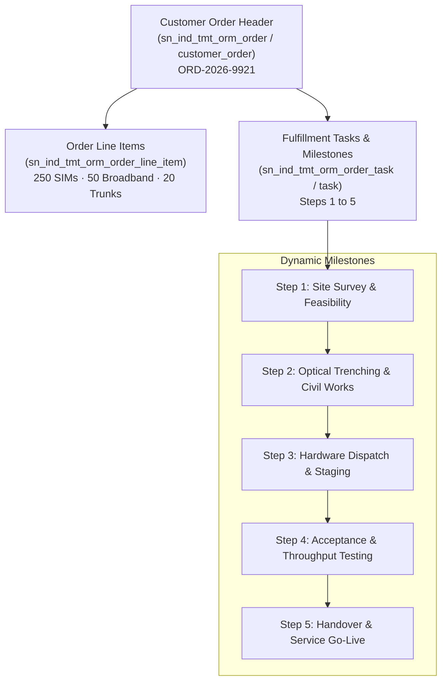

# Customer Project Orders: ServiceNow Data Architecture & End-to-End Implementation Specification

## Executive Summary
This document provides a comprehensive technical reference for the **Customer Project Orders** page in the Tata B2B Customer Care Self-Service Portal. It details the exact data architecture, table relationships, Scripted REST API enhancements, milestone/task fulfillment modeling, and client ingestion logic connecting the portal to ServiceNow.

---

## 1. Enterprise Telecom Order Lifecycle Architecture

In enterprise telecommunications and ServiceNow Order Management for Telecommunications (OMT), an order progresses through structured fulfillment stages represented across three distinct layers:



---

## 2. Table-to-Field Mapping Matrix

### 2.1 Order Header (`sn_ind_tmt_orm_order` / `customer_order`)

| Portal Field | Database Column | Data Type | Description |
| :--- | :--- | :--- | :--- |
| **Order Number** | `order_number` or `number` | String | Unique telecom project order identifier (e.g. `ORD-2026-9921`) |
| **Project Title** | `product_name` or `short_description` | String | Commercial product bundle or circuit expansion package |
| **Site Location** | `site_location` | String / Reference | Premises where the circuit or infrastructure is being delivered |
| **Site Code** | `site_code` (or derived) | String | Standard telecom location identifier (`PUN-01`, `MUM-HQ`, `CHE-01`, `BLR-01`, `SGP-01`) |
| **Stage** | `stage` | Choice | Current delivery lifecycle state (`Site Survey`, `Provisioning`, `Testing`, `Delivered`) |
| **Status** | `status` | Choice | Workflow governance status (`Draft`, `In Progress`, `Pending Acceptance`, `Completed`) |
| **Target Delivery** | `target_delivery_date` | Date / DateTime | Committed customer readiness date (CRD) |
| **Created On** | `sys_created_on` | DateTime | Timestamp when the order was staged in ServiceNow |
| **Summary** | `description` | String | Detailed capacity specifications (e.g. `250 Mobile SIM Lines · 50 Broadband Circuits`) |
| **Monthly Cost** | `monthly_recurring_cost` | Currency / Decimal | Monthly Recurring Charge (MRC) for the active bundle |

---

### 2.2 Fulfillment Tasks & Milestones (`sn_ind_tmt_orm_order_task` / `task`)

| Portal Milestone Attribute | Task Database Column | Mapping Logic |
| :--- | :--- | :--- |
| **Milestone Name** | `short_description` or `name` | Task title (e.g. `Site Survey & Engineering Review`) |
| **Step Sequence** | `order` or `order_index` | Integer sequence (`1` to `5`) |
| **Status** | `state` | `complete` (states 3, 4, 7, closed_complete)<br>`current` (state 2, in_progress)<br>`pending` (state 1, pending) |
| **Completion Date** | `closed_at` / `expected_start` | Formatted date string (`DD Mon YYYY`) |

---

### 2.3 Order Line Items (`sn_ind_tmt_orm_order_line_item`)

| Portal Item Attribute | Line Item Column | Mapping Logic |
| :--- | :--- | :--- |
| **Category** | `product_family` or `category` | `Broadband`, `Mobile Fleet`, `Voice & SIP`, `Interconnect`, `Wi-Fi APs` |
| **Description** | `short_description` or `product` | Component description (e.g. `50 Broadband Circuits`) |
| **Quantity** | `quantity` | Integer quantity |
| **Unit** | `u_unit` / derived | `Circuits`, `SIMs`, `Trunks`, `Access Points`, `Cross-Connects` |
| **Fulfillment Status** | `stage` | `Provisioning`, `Testing`, `Delivered` |

---

## 3. Scripted REST API Specification

### Endpoint: `GET /api/taair/b2b_auth_api/orders`

#### Parameters:
- `user_name` (optional): Username for context resolution (defaults to authenticated session or `goutam.hazra`).

#### Response Structure:
```json
{
  "result": [
    {
      "sys_id": "061c4c012b409b1016f8f0aef291bf83",
      "order_number": "ORD-2026-9921",
      "product_name": "Global Enterprise SD-WAN & 5G Mobility Transformation Bundle",
      "order_type": "Macro Rollout",
      "site_location": "Chennai Technology Park",
      "site_code": "CHE-01",
      "stage": "Provisioning",
      "status": "In Progress",
      "progress_pct": 68,
      "summary": "250 Mobile SIM Lines · 50 Broadband Circuits · 20 Voice Trunks",
      "target_delivery_date": "2026-10-29",
      "created_at": "2026-10-15 08:30:00",
      "monthly_recurring_cost": 14200,
      "items": [
        {
          "category": "Mobile Fleet",
          "description": "250 Mobile SIM Lines",
          "quantity": 250,
          "unit": "SIMs",
          "status": "Provisioning"
        },
        {
          "category": "Broadband",
          "description": "50 Broadband Circuits",
          "quantity": 50,
          "unit": "Circuits",
          "status": "Provisioning"
        },
        {
          "category": "Voice & SIP",
          "description": "20 Voice Trunks",
          "quantity": 20,
          "unit": "Trunks",
          "status": "Provisioning"
        }
      ],
      "stages": [
        {
          "name": "Site Survey & Engineering Review",
          "status": "complete",
          "date": "15 Oct 2026"
        },
        {
          "name": "Optical Network Trenching & Feasibility",
          "status": "complete",
          "date": "15 Oct 2026"
        },
        {
          "name": "CPE Router Hardware Dispatch & Staging",
          "status": "current",
          "date": "Provisioning"
        },
        {
          "name": "End-to-End Acceptance Testing",
          "status": "pending"
        },
        {
          "name": "Handover & Service Go-Live",
          "status": "pending",
          "date": "2026-10-29"
        }
      ],
      "_source": "database"
    }
  ],
  "_source": "database"
}
```

---

## 4. Frontend Resilience & Dual-Mode Processing

The client service in `src/services/servicenowApi.ts` implements defensive ingestion:
1. **Direct Ingestion:** When the enhanced REST API returns `stages` and `items`, the client binds to them directly without modification.
2. **Dynamic Client Fallback (Zero Mock):**
   - If `stages` are not yet populated on older database records, the frontend derives the 5-step milestone sequence dynamically from `sys_created_on` and `target_delivery_date`.
   - **All hardcoded fake dates (`12 Oct 2026`, `18 Oct 2026`) have been permanently purged.**
   - Site code is dynamically resolved from the order's actual site location.
   - Package items are dynamically parsed from the order's real specification description.
