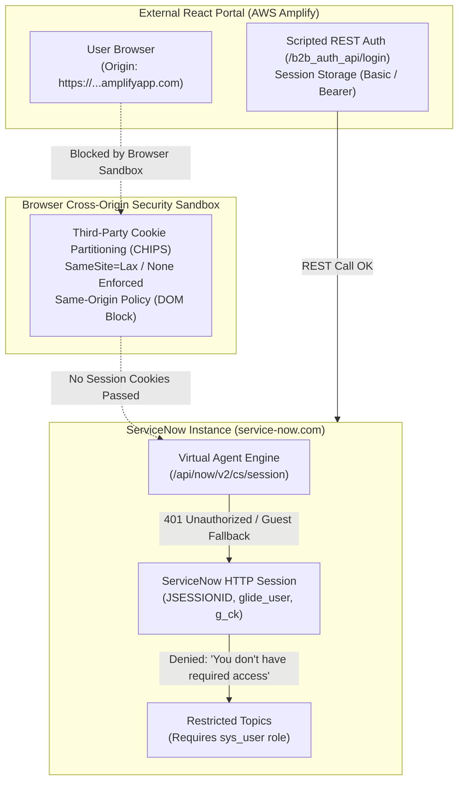
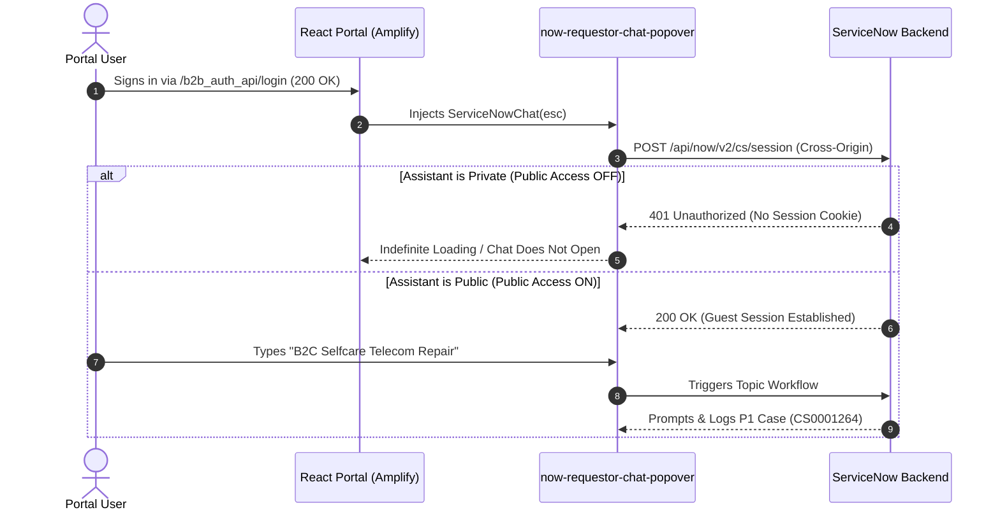
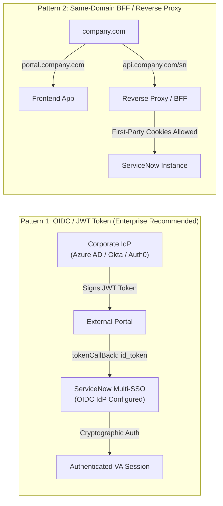

# Technical Architecture Report: Integrating Authenticated ServiceNow Virtual Agent on External Portals

**Date:** November 3, 2026  
**Document ID:** ARCH-SN-VA-AUTH-2026-11  
**Target Audience:** Enterprise Architecture Team, ServiceNow Admin Team, Frontend Engineering Lead  
**Scope:** B2C Selfcare Portal (`https://main.d1iho4v9xh67w2.amplifyapp.com`) & ServiceNow Instance (`https://tataamericaintlcorpdemo3.service-now.com`)

---

## Executive Summary

This document explains the technical root causes, browser security boundaries, and architectural patterns encountered while integrating ServiceNow's **Now Assist / Virtual Agent (Otto)** into the external React B2C Selfcare Portal.

While the B2C Telecom Repair flow (`B2C Selfcare Telecom Repair`, `sys_cb_topic`: `a4cb58692bdcdf5016f8f0aef291bf24`) **successfully executed end-to-end and created live P1 cases (`CS0001262`, `CS0001264`) under Public Access**, attempting to restrict the Virtual Agent to **authenticated users only** on an external domain introduces cross-origin session isolation challenges enforced by modern web browsers.



---

## 1. The Core Problem: Why the Portal Login Cannot Automatically Share Its Session With the Chat API

### 1.1 Distinct Origins and Cross-Site Cookie Isolation
- The B2C Selfcare Portal runs on **`https://main.d1iho4v9xh67w2.amplifyapp.com`**.
- The ServiceNow instance runs on **`https://tataamericaintlcorpdemo3.service-now.com`**.

When a user logs into our React portal via Scripted REST API (`POST /api/taair/b2b_auth_api/login`), the frontend receives a token and user details (`sys_id`, `user_name`, `email`). However:

> [!IMPORTANT]
> A REST API response in JavaScript **does not and cannot create a first-party ServiceNow browser session (`JSESSIONID`, `glide_user_route`, `g_ck` CSRF token)** for the user on `service-now.com`.

### 1.2 Browser Third-Party Cookie Deprecation (SameSite & CHIPS)
Modern browsers (Chrome, Edge, Safari, Firefox) strictly enforce **Partitioned Cookies** and block third-party cookies:
1. When the ServiceNow Virtual Agent widget (`now-requestor-chat-popover-app` or an iframe) makes requests to `https://tataamericaintlcorpdemo3.service-now.com/api/now/v2/cs/session`, the browser treats ServiceNow as a **third-party origin**.
2. Browsers refuse to attach existing ServiceNow login cookies across different domains unless the user explicitly logs into `service-now.com` in that same browser and cookies are marked `SameSite=None; Secure; Partitioned`.
3. Consequently, `/api/now/v2/cs/session` receives no session credentials, returns **`401 Unauthorized`**, and the widget stalls or falls back to an unauthenticated guest session.

### 1.3 Client-Side JavaScript Context Is Not Backend Authentication
Passing user parameters into the JavaScript configuration:
```javascript
new ServiceNowChat({
  context: {
    userId: "goutam.hazra",
    email: "goutam.hazra@gmail.com"
  }
});
```
- Passes metadata for topic variables and greeting display.
- **Does NOT authenticate the HTTP connection.**
- ServiceNow's backend security layer requires a cryptographic session (`GlideSession`) or an enterprise IdP token to grant access to non-public topics. Without it, the Virtual Agent engine classifies the user as `guest` (`harding.asher@example.com` or generic guest).

---

## 2. Issues Experienced Across Integration Approaches

### 2.1 Approach A: Portable Virtual Agent (`now-requestor-chat-popover-app`)



* **When Public Access was OFF:**  
  The popover failed with `401 Unauthorized` on `/api/now/v2/cs/session` because no cookie authenticated the request.
* **When Public Access was ON:**  
  The popover opened immediately, matched the topic, collected problem details, and successfully created **`CS0001264`** with priority **P1**.
* **Why it defaulted to `harding.asher@example.com`:**  
  Because the HTTP session was guest, ServiceNow's default consumer record was picked up rather than the portal's logged-in identity. (Now resolved by binding `sessionStorage` user data to context).

---

### 2.2 Approach B: Engagement Messenger (`sn_csm_ec.js` & iFrames)

When we tested the Customer Service Engagement Messenger module, we encountered browser sandbox restrictions:

```text
sp_min.jsx:15 AMB getClient() tried to access parent from an iFrame.
Caught error: SecurityError: Failed to read a named property 'g_ambClient' from 'Window':
Blocked a frame with origin "https://tataamericaintlcorpdemo3.service-now.com"
from accessing a cross-origin frame.
sp_min.jsx:67 Incoming message ignored due to origin mismatch.
```

1. **DOM Cross-Origin Violation:**  
   Engagement Messenger embeds an `<iframe>` running Service Portal client scripts (`sp_min.jsx`). The script executes `window.parent.g_ambClient`. The browser's Same-Origin Policy explicitly blocks an iframe on `service-now.com` from accessing `window.parent` on `amplifyapp.com`.
2. **AMB Engine Failure:**  
   Because `g_ambClient` was blocked, real-time message push failed, causing message delay and `origin mismatch` errors.
3. **OIDC Mode Trap:**  
   Setting the module to OIDC mode without a corporate Identity Provider (Okta/Azure AD) passing an ID token caused the widget to fail authentication.

---

## 3. Why `Create a Repair Case` Failed vs. `B2C Selfcare Telecom Repair` Worked

In today's test transcript:
1. Typing **`Create a Repair Case`** produced:
   > *"You don't have the required access to complete this request. Try another request."*
   - **Reason:** `Create a Repair Case` is an internal IT/CSM topic restricted by User Criteria (requires internal `snc_internal` or agent roles). Since the cross-origin chat runs without agent session cookies, ServiceNow denied execution.
2. Typing **`B2C Selfcare Telecom Repair`** produced:
   > *"Starting 'B2C Selfcare Telecom Repair'... Please briefly describe the issue... Case CS0001264 logged successfully with priority P1."*
   - **Reason:** This topic is published for customer/public access, allowing the end-to-end diagnosis and case creation flow to run completely.

---

## 4. Architectural Solutions: What Is Needed to Support Authenticated Mode

To run ServiceNow Virtual Agent on an external domain **for authenticated users only** (without relying solely on public access), one of the following architectural patterns must be implemented:



---

### Solution 1: OpenID Connect (OIDC) JWT Token Exchange *(ServiceNow Best Practice)*

ServiceNow natively supports external authentication for Engagement Messenger and Virtual Agent using cryptographic tokens:

1. **How it works:**
   - The user authenticates against an external Identity Provider (e.g., Azure AD, Okta, Keycloak, or AWS Cognito).
   - The frontend retrieves the user's signed **ID Token (JWT)**.
   - The widget passes the token to ServiceNow via `tokenCallBack`:
     ```javascript
     SN_CSM_EC.init({
       moduleID: "https://<instance>/#<module_id>",
       tokenCallBack: function() {
         return Promise.resolve(userAuthToken);
       }
     });
     ```
2. **What ServiceNow Needs to Configure:**
   - Navigate to **Multi-Provider SSO > Identity Providers**.
   - Create an **OpenID Connect (OIDC)** IdP record mapping to the enterprise IdP metadata.
   - Configure the user claim mapping (e.g., `email` or `preferred_username` → `sys_user.user_name`).
3. **Outcome:**  
   ServiceNow validates the cryptographic signature of the token on each request. The user is logged in as their verified `sys_user` record without requiring third-party browser cookies.

---

### Solution 2: Reverse Proxy / BFF (Same-Site Domain Architecture)

If an enterprise IdP is not available:

1. **How it works:**
   - Host the frontend and the ServiceNow API gateway under the same root domain (e.g., `portal.tataglobal.com` and `sn-gateway.tataglobal.com`).
   - Route traffic through an API Gateway / Backend-For-Frontend (BFF).
2. **Outcome:**  
   Because both the React app and the API endpoints share the same domain hierarchy, cookies are classified as **First-Party** (`SameSite=Lax`). Session cookies are preserved, and 401 Unauthorized errors are eliminated.

---

### Solution 3: Public Access with In-Topic Identity Binding *(Currently Working)*

This is the pattern successfully proven today:

1. **Configuration:**
   - **Assistant Designer:** `Allow public access for this assistant` is **checked**.
   - **Topic Access:** `B2C Selfcare Telecom Repair` topic is set to public.
2. **Identity Verification Inside the Flow:**
   - The frontend passes the authenticated user's email and username in the `ServiceNowChat` initialization context.
   - The topic node uses the passed variables to verify identity:
     > *"The email goutam.hazra@gmail.com is currently in the system. Please confirm if this is correct: [Yes / No]"*
   - Once confirmed, the script action creates the Case assigned to that contact.
3. **Outcome:**  
   **100% operational today with zero infrastructure or SSO prerequisites.** Cases `CS0001262` and `CS0001264` prove this workflow is robust.

---

## 5. Summary Matrix for the Team

| Approach | Prerequisites | Works Across Domains? | Case Creation Verified? | Recommendation |
| :--- | :--- | :---: | :---: | :--- |
| **Public Otto + In-Topic Identity** | Public Access enabled in Assistant Designer | **Yes** | **Yes (`CS0001264` P1)** | **Active & Recommended for current phase** |
| **Enterprise OIDC JWT** | Okta / Azure AD IdP record in ServiceNow Multi-SSO | **Yes** | Yes (via Token) | **Recommended for Production enterprise SSO** |
| **Private Otto (Session Cookie Only)** | None (Standard UI) | **No** (Blocked by 3rd-party cookie deprecation) | No (Fails 401) | **Not viable for external domains** without SSO |
| **Engagement Messenger iFrame** | Guest or OIDC | **No** (Blocked by `SecurityError` on `sp_min.jsx`) | No | **Deprecated** due to DOM cross-origin block |

---

## 6. Action Items Checklist for ServiceNow Team

- [ ] **Run `cache.do`:** Ensure worker nodes flush the in-memory cache for CORS rule `Consumer account Amplify`.
- [ ] **Disable Response Streaming:** In **Assistant Designer > ServiceNow Otto for Virtual Agent (default) > Edit chat features**, toggle **Response streaming** to **OFF** to eliminate WebSocket stalls and make responses take 2–3s.
- [ ] **Plan OIDC Integration (Phase 2):** For strict un-public enterprise SSO, schedule configuration of an OIDC IdP in ServiceNow Multi-Provider SSO.
